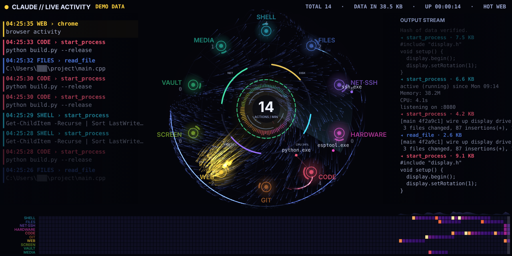

# claude-viz

A live visualizer for what Claude is doing on your Windows PC. It runs in its own resizable window and costs zero tokens, because it only reads log files Claude's tools already write locally.



*Screenshot shows demo mode (press `D`), not a real session.*

See it move: [8-second clip](media/claude-viz-wide.mp4) · [vertical cut](media/claude-viz-vertical.mp4) (both recorded in demo mode).

This is an unofficial community project. It is not made by or affiliated with Anthropic.

## What you see

- **Subsystem nodes**: SHELL, FILES, NET·SSH, HARDWARE, CODE, GIT, WEB, SCREEN, VAULT, MEDIA. Each tool call fires packets from the core to its node; results flow back.
- **Ticker**: every action with its command, path, or query.
- **Output stream**: the text that came back from each command, and the bodies of files being written.
- **Process satellites**: programs launched by Claude's commands (ssh, python, esptool) orbit their node.
- **Telemetry arcs**: real CPU, RAM, network, and disk for the machine.
- **Heat map**: activity per subsystem over time.

## Requirements

- Windows 10 or 11
- Python 3.9+ on PATH (standard library only, nothing to install)
- Chrome or Edge
- At least one of the sources below producing activity

## Run it

Double-click `Claude Viz.cmd`. It starts the feed in the background and opens the window. `Stop Claude Viz.cmd` shuts the feed down.

For OBS, window-capture it or add `http://127.0.0.1:47800` as a browser source. Add `?demo` to the URL for synthetic data.

## Where the data comes from

`server.py` tails these and streams events to the page over Server-Sent Events. It is read-only, binds to `127.0.0.1` only, and never contacts Claude or any remote host.

| Source | Location | Shows |
|---|---|---|
| [Desktop Commander](https://github.com/wonderwhy-er/DesktopCommanderMCP) calls | `~\.claude-server-commander\claude_tool_call.log` | Every call with its command or path |
| Desktop Commander results | `~\.claude-server-commander\tool-history.jsonl` | Returned output for the stream panel |
| Claude desktop app | `%LOCALAPPDATA%\Claude\Logs\main.log` | Device tool calls, file transfers, tools-engaged state |
| Local MCP servers | `%LOCALAPPDATA%\Claude\Logs\mcp-server-*.log` | A pulse per `tools/call` (no detail is logged) |
| Claude Code | `~\.claude\projects\**\*.jsonl` | `tool_use` blocks from local sessions |
| Process creation | WMI events via a hidden PowerShell helper | Programs spawned under Desktop Commander commands |
| Performance counters | `typeperf` | CPU, RAM, network, disk |

Desktop Commander is the richest source. Without it you still get Claude Code activity and telemetry.

Limits worth knowing:

- Anything Claude does purely in the cloud (web search, its own sandbox) is not logged locally, so it does not appear on its own. See the next section.
- Process creation is polled once a second, so programs that exit faster than that are missed.
- Log paths and formats belong to those apps and can change between versions.

## Showing cloud-side steps (optional, costs a few tokens)

Ask Claude to report its cloud steps by running a no-op PowerShell comment through Desktop Commander:

```
# cviz: WEB|web_search|esp32 c5 datasheet ;; CODE|sandbox|ran 14 tests
```

Each `SYSTEM|tool|detail` item becomes its own event. This is one small tool call per batch, so use it when recording rather than all the time.

## Keys

| Key | Action |
|---|---|
| `D` | Demo data (header shows DEMO DATA) |
| `R` | Redaction on/off |
| `O` | Output stream on/off |
| `H` | Hide all text |
| `F` | Fullscreen |

## Privacy

The ticker and output stream show real commands and real output. Redaction is on by default and masks IPv4 addresses, `user@`, the Windows username in paths, long token-like strings, and values after `password`, `token`, or `secret`. It is pattern-based and will not catch everything, so review footage before publishing, and press `O` to hide the output stream during sensitive work.

## Customizing

- Subsystem names and colors: `SYS` at the top of `index.html`
- How shell commands are sorted into subsystems: `classify_cmd()` in `server.py`
- Port: set `CLAUDE_VIZ_PORT` before starting

## Community

Questions, builds, and ideas for what it should show next: join the [MonsterMesh Discord](https://discord.gg/WsWwzR4qqx).

## License

MIT
